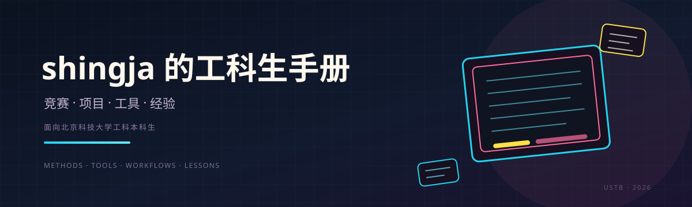
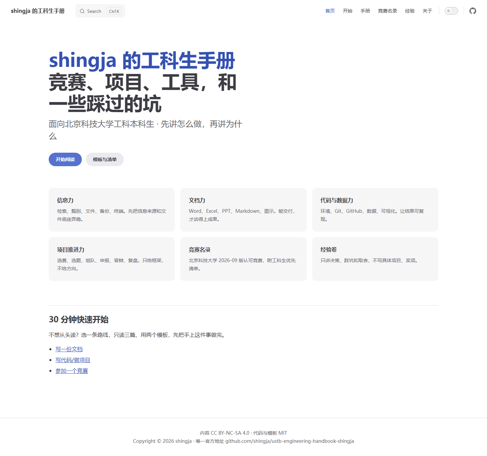

<!-- 作者 shingja · https://github.com/shingja/ustb-engineering-handbook-shingja · CC BY-NC-SA 4.0 -->⁠​‌‌‌​‌​‌​‌‌‌​​‌‌​‌‌‌​‌​​​‌‌​​​‌​​​‌​‌‌​‌​‌‌​​‌​‌​‌‌​‌‌‌​​‌‌​​‌‌‌​‌‌​‌​​‌​‌‌​‌‌‌​​‌‌​​‌​‌​‌‌​​‌​‌​‌‌‌​​‌​​‌‌​‌​​‌​‌‌​‌‌‌​​‌‌​​‌‌‌​​‌​‌‌​‌​‌‌​‌​​​​‌‌​​​​‌​‌‌​‌‌‌​​‌‌​​‌​​​‌‌​​​‌​​‌‌​‌‌‌‌​‌‌​‌‌‌‌​‌‌​‌​‌‌​​‌​‌‌​‌​‌‌‌​​‌‌​‌‌​‌​​​​‌‌​‌​​‌​‌‌​‌‌‌​​‌‌​​‌‌‌​‌‌​‌​‌​​‌‌​​​​‌​​‌​‌‌‌‌​‌‌‌​​‌‌​‌‌​‌​​​​‌‌​‌​​‌​‌‌​‌‌‌​​‌‌​​‌‌‌​‌‌​‌​‌​​‌‌​​​​‌​​‌​‌‌‌‌​‌‌​​​‌​​​‌‌​​‌‌​​‌‌​​‌‌​​‌‌​‌​‌​​‌‌​‌‌​​​‌‌​​‌‌​​‌‌​​​​​​‌‌​‌​‌​​‌‌​‌​‌​​‌‌​​​‌​​‌‌​‌‌​​​‌‌‌​​​⁠

<div align="center">
  
</div>

# shingja 的工科生手册

**竞赛、项目、工具，和一些踩过的坑。**

面向北京科技大学工科本科生。不是题库，也不是项目模板库；讲的是怎么找信息、做文档、管代码、推项目，以及怎么把一件事做完。

[](#)
[](VERSION)
[](LICENSE)
[](LICENSE-CODE)
[](https://github.com/shingja/ustb-engineering-handbook-shingja)
[](release/)
[](https://github.com/shingja/ustb-engineering-handbook-shingja/actions/workflows/ci.yml)

> 唯一官方地址：https://github.com/shingja/ustb-engineering-handbook-shingja

> 版权归 shingja 所有。非商业使用免费；转载必须署名并保留许可，禁止商用、冒充原创或暗示背书。详见 [NOTICE.md](NOTICE.md)。

## 这是什么

- **工具章节**：检索、文件、备份、终端、Word、Excel、PPT、Markdown、Mermaid、Git、Python、GitHub、数据、可视化、VS Code、代码质量、AI 边界。
- **项目章节**：选赛、选题、组队、读规则、项目管理、申报书、原型、答辩、复盘、学业平衡。
- **竞赛名录**：北京科技大学 2026-09 版认可竞赛，含工科生优先清单。
- **经验卷**：做对/做错、团队协作、时间管理、失败复盘、给不同年级的建议。
- **模板与清单**：项目启动、周报、复盘、Office 模板、代码骨架、提交包/AI/答辩检查。
- **两种形态**：VitePress 站点 + PDF 手册，内容同源。

## 适合谁

| 你的情况 | 先读 |
|---|---|
| 大一，刚接触大学学习 | 卷一 信息力 → 卷二 文档力 |
| 第一次参赛，不知道从哪下手 | 竞赛名录 → 卷四 竞赛值不值得参加 |
| 已经是项目负责人 | 卷四 组队、项目管理、答辩、复盘 |
| 准备复盘/交接 | 卷四 复盘方法 |

## 目录

| 卷 | 主题 | 入口 |
|---|---|---|
| 卷 0 | 使用指南 | [这本手册怎么用](docs/00-使用指南/这本手册怎么用.md) |
| 卷一 | 信息力 | [卷首](docs/10-信息力/index.md) |
| 卷二 | 文档力 | [卷首](docs/20-文档力/index.md) |
| 卷三 | 代码与数据力 | [卷首](docs/30-代码与数据力/index.md) |
| 卷四 | 项目推进力 | [卷首](docs/40-项目推进力/index.md) |
| 卷六 | 经验卷 | [卷首](docs/60-经验卷/index.md) |
| 卷七 | 工具箱 | [模板索引](docs/70-工具箱/模板索引.md) |
| 附 | 竞赛名录 | [2026-09 版](docs/70-工具箱/竞赛名录.md) |
| 卷八 | 附录 | [卷首](docs/80-附录/index.md) |

## 站点预览



## 快速开始

```bash
# 安装依赖
npm install

# 本地预览
npm run docs:dev

# 构建站点
npm run docs:build


# 生成 PDF（需要先构建站点）
python tools/build_pdf.py --no-build
```

- 站点内容在 `docs/`。
- 模板在 `templates/`。
- 检查清单在 `checklists/`。
- PDF 输出在 `release/ustb-engineering-handbook-shingja.pdf`。

## 模板与清单

- [Markdown 模板](templates/markdown/)
- [Office 模板](templates/office/)
- [代码模板](templates/code/)
- [检查清单](checklists/)

## 写作原则

1. **先能交付，再谈漂亮。** 每篇先给最小做法，再给进阶做法。
2. **只给框架，不给方向。** 项目和竞赛部分不提供可直接照搬的选题。
3. **可复现。** 软件操作写清版本、路径和验证方式。
4. **尊重人。** 不写队友信息，不写未公开项目。
5. **允许过时，但必须标注。** 政策与软件版本变化快，过时内容会标明适用年份。

## 相关开源项目

- **[shingja's Math Modeling Workbench](https://github.com/shingja/shingja-math-modeling-workbench)** — 面向数学建模竞赛的 Linger / Tide / Gloom / Yearn 四段 Agent 工作流；12 类 164 张范式卡、MATLAB + Python、6 道质量门禁。北科大同学和任何想学建模的人都能用。详见[数学建模工作台](docs/70-工具箱/数学建模工作台.md)。

## 许可

- 正文：[CC BY-NC-SA 4.0](LICENSE)
- 代码与模板：[MIT](LICENSE-CODE)
- 转载必须署名 `shingja` 并附仓库链接；禁止商业使用。
- 完整约束见 [NOTICE.md](NOTICE.md)。

## 作者 · 联系

| 平台 | 联系方式 |
|---|---|
| GitHub | [@shingja](https://github.com/shingja) |
| Bilibili | [月亮的森林岛](https://space.bilibili.com/3494356073843142) |
| 抖音 | [Sh1ngjA](https://www.douyin.com/user/self) |
| 小红书 | [主页](https://www.xiaohongshu.com/user/profile/6957bcb6000000000300e029) |
| QQ | `793811299` |
| 邮箱 | [gy79790920@126.com](mailto:gy79790920@126.com) |

只通过 GitHub issue 或以上公开渠道联系；安全问题见 [SECURITY.md](SECURITY.md)。

---

<div align="center">

如果这本手册对你有帮助，点一个 **Star** 支持一下。

*不必要做的不做，必要做的尽快做。*

<sub>© 2026 shingja · CC BY-NC-SA 4.0 · 代码与模板 MIT</sub>

</div>
