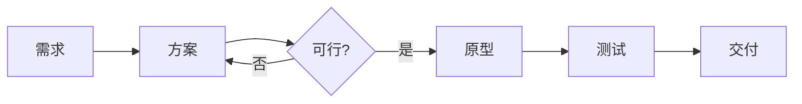
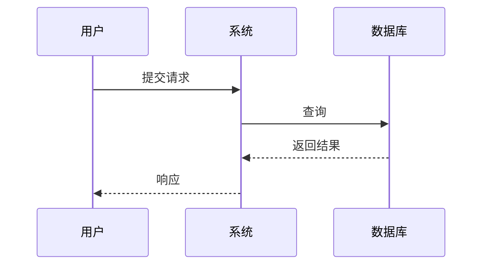
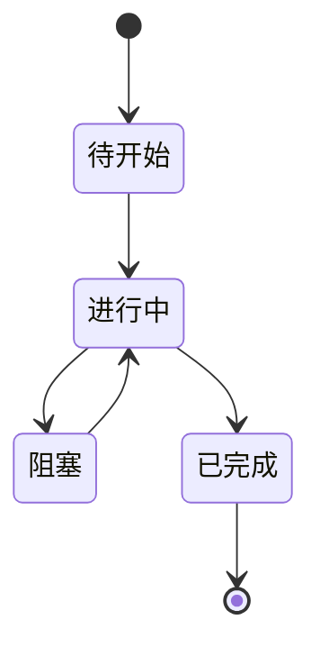

<!-- 作者 shingja · https://github.com/shingja/ustb-engineering-handbook-shingja · CC BY-NC-SA 4.0 -->⁠​‌‌‌​‌​‌​‌‌‌​​‌‌​‌‌‌​‌​​​‌‌​​​‌​​​‌​‌‌​‌​‌‌​​‌​‌​‌‌​‌‌‌​​‌‌​​‌‌‌​‌‌​‌​​‌​‌‌​‌‌‌​​‌‌​​‌​‌​‌‌​​‌​‌​‌‌‌​​‌​​‌‌​‌​​‌​‌‌​‌‌‌​​‌‌​​‌‌‌​​‌​‌‌​‌​‌‌​‌​​​​‌‌​​​​‌​‌‌​‌‌‌​​‌‌​​‌​​​‌‌​​​‌​​‌‌​‌‌‌‌​‌‌​‌‌‌‌​‌‌​‌​‌‌​​‌​‌‌​‌​‌‌‌​​‌‌​‌‌​‌​​​​‌‌​‌​​‌​‌‌​‌‌‌​​‌‌​​‌‌‌​‌‌​‌​‌​​‌‌​​​​‌​​‌​‌‌‌‌​‌‌‌​​‌‌​‌‌​‌​​​​‌‌​‌​​‌​‌‌​‌‌‌​​‌‌​​‌‌‌​‌‌​‌​‌​​‌‌​​​​‌​​‌​‌‌‌‌​‌‌​​​‌‌​​‌‌​‌‌‌​​‌‌​​​‌​‌‌​​‌‌​​‌‌​​‌‌​​‌‌​​​‌​​‌‌​​‌​‌​‌‌​​‌​‌​‌‌​​‌​​​​‌‌​​‌​​‌‌​​​​‌​​‌‌‌​​‌⁠

# Mermaid 与 draw.io 图示

## 适用场景

你要在文档/答辩里画流程、系统架构、任务时序、状态机；用截图或手绘图，改一次就要重画。

## 最小做法

### Mermaid：文本画图

流程图：

时序图：

状态图：

规则：

- 一张图只表达一个结构。
- 节点文字短，动词开头。
- 方向统一：从左到右或从上到下。
- 颜色不超过 3 种，重点节点加粗。

### draw.io：拖拽画图

适合：系统架构、硬件框图、流程排版要求高的图。

步骤：

1. 新建空白图，选横向/纵向。
2. 先放主流程，再补分支。
3. 用对齐/分布工具，不要手动对。
4. 统一字体、字号、线宽。
5. 导出 SVG（可编辑）或 PNG（300 DPI）。

## 进阶做法

- Mermaid 放 Markdown 里，Git 可 diff，改文字就改图。
- 复杂架构用 draw.io，导出 SVG 嵌进文档。
- 给图加图注：图号、标题、数据来源。
- 用子图（subgraph）分组，减少连线交叉。
- 答辩图放大到一页一个，不要塞 10 个节点。

## 常见坑

- 图里文字太小，投影看不清。
- 连线交叉，读者跟着线跑丢。
- 一张图同时画流程、架构、数据流，信息过载。
- 用截图代替源文件，改一个字要重画。
- 颜色太多，重点不突出。
- 导出 PNG 分辨率不够，打印模糊。
- Mermaid 语法在 GitHub/本地编辑器渲染不一致。

## 自检清单

- [ ] 一张图只表达一个结构。
- [ ] 节点文字短，方向统一。
- [ ] 颜色不超过 3 种，重点突出。
- [ ] 图有图号和标题。
- [ ] 源文件保留（`.mmd`、`.drawio`）。
- [ ] 导出 SVG 或 300 DPI PNG。
- [ ] 投影/打印后能看清。

## 版本与时效

本文基于 Mermaid 11、draw.io 24。语法和导出选项会变，但“源文件 + 矢量导出 + 一张图一个结论”的原则不变。
